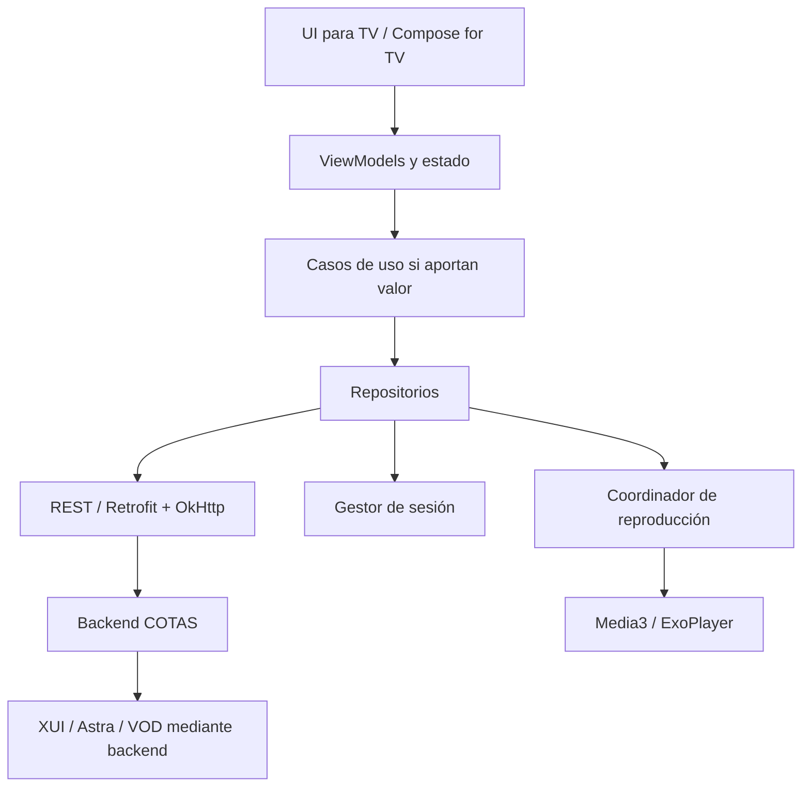

# 02. Arquitectura del cliente

**Estado:** propuesta previa a implementación.

## Responsabilidades
- **UI:** pantallas de login, catálogo y reproducción; foco y navegación con mando. No realiza HTTP directamente.
- **ViewModels:** orquestan eventos y exponen estados explícitos; no bloquean el hilo principal.
- **Dominio:** casos de uso para login, catálogo, cierre de sesión y reproducción, si la complejidad lo justifica.
- **Datos:** repositorios, cliente API, DTO y mapeo uniforme de errores.
- **Reproductor:** ciclo de vida de Media3, estados de reproducción y liberación de recursos.

## Stack de referencia
| Área | Referencia | Estado |
|---|---|---|
| Lenguaje | Kotlin | Propuesto en Sprint 4 |
| UI | Jetpack Compose for TV | Propuesto; validar compatibilidad |
| Reproductor | AndroidX Media3 / ExoPlayer | Propuesto; protocolos pendientes |
| HTTP | Retrofit + OkHttp | Propuesto |
| Asincronía | Coroutines y Flow | Propuesto |
| Pruebas | JUnit y herramientas Android | Propuesto |

Las versiones se fijarán tras inspeccionar el repositorio y los dispositivos objetivo.

## Límites de confianza
La app llama únicamente a la API COTAS. No accede directamente a PostgreSQL, XUI, Astra o VOD. El backend valida identidad, catálogo y reproducción. Ocultar botones en la UI no sustituye autorización en servidor.

## Reglas
1. No hacer trabajo de red en el hilo principal.
2. Mantener un dueño claro del ciclo de vida del reproductor.
3. Separar errores de autenticación, red, catálogo y reproducción.
4. No añadir dependencias sin justificación.
5. Distinguir pruebas con dobles de pruebas end-to-end reales.
