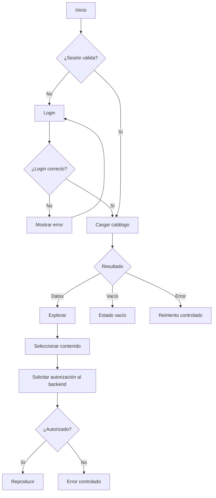

# 04. Interfaz y navegación con control remoto

**Estado:** especificación UX previa a implementación.

## Principios
- Diseñar para distancia de visualización y D-pad.
- Mantener foco visible y orden predecible.
- No depender de gestos táctiles, hover o teclado físico.
- Usar tipografía legible, contraste suficiente y márgenes adecuados.
- Mostrar carga, vacío y error dentro del área de contenido.

## Flujo propuesto

## Pantallas mínimas
- **Login:** campos según contrato real, foco inicial, indicador de envío y error no sensible.
- **Catálogo:** datos reales del backend, carga/vacío/error y reintento explícito.
- **Reproductor:** controles apropiados, estados claros, salida controlada y liberación de recursos.

## Controles
| Entrada | Comportamiento |
|---|---|
| D-pad | Mover foco en orden lógico |
| OK/Seleccionar | Activar elemento enfocado |
| Atrás | Volver; desde reproductor, detener y salir de forma controlada |
| Teclado en pantalla | Introducir credenciales |
| Play/Pause dedicado | Atender si dispositivo y reproductor lo soportan |

## Aceptación UX
Todos los flujos principales deben operarse con mando; el foco no se pierde durante carga/error; no hay pantallas bloqueadas; validar emulador y, cuando esté disponible, dispositivo real.

## Pendientes
Branding, paleta, tamaños de pantalla objetivo, diseño de catálogo/detalle/reproductor, categorías visibles y accesibilidad.
