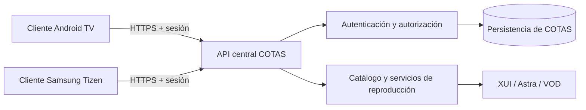

Requisitos y medidas de seguridad para clientes IPTV COTAS
Google TV / Android TV y Samsung Smart TV / Tizen
Organización: COTAS PERU S.A.C.  
Sistema: Aplicaciones IPTV para televisores y API central COTAS  
Versión: 1.0  
Estado: Especificación de seguridad propuesta; requiere validación técnica, análisis de riesgos y aprobación del responsable de seguridad.
---
1. Propósito
Establecer requisitos de seguridad comunes para los clientes IPTV de COTAS en Google TV / Android TV y Samsung Smart TV / Tizen. Las aplicaciones ofrecen los mismos servicios y deben aplicar las mismas reglas de negocio y seguridad; las diferencias se limitan a los mecanismos técnicos disponibles en cada sistema operativo.
El documento busca apoyar la alineación del diseño, desarrollo, pruebas, operación y mantenimiento con la familia ISO/IEC 27000, en particular:
ISO/IEC 27000: conceptos y visión general de los sistemas de gestión de seguridad de la información (SGSI).
ISO/IEC 27001:2022: requisitos para establecer, operar, evaluar y mejorar un SGSI, incluyendo evaluación y tratamiento de riesgos.
ISO/IEC 27002:2022: guía de controles de seguridad que puede utilizarse para seleccionar y aplicar medidas adecuadas.
La alineación descrita aquí es una propuesta de controles para el producto. No equivale a una certificación ISO ni demuestra por sí sola la conformidad de COTAS con ISO/IEC 27001. La aplicabilidad final de los controles debe establecerse mediante el análisis de riesgos, la Declaración de Aplicabilidad y el SGSI de la organización.
2. Alcance
Incluye:
Aplicación Google TV / Android TV.
Aplicación Samsung Smart TV basada en Tizen Web.
Comunicación de ambos clientes con la API central de COTAS.
Autenticación, sesiones, catálogo, autorización de contenido y reproducción.
Datos almacenados temporalmente en el televisor y datos transmitidos.
Paquetes de distribución, configuración, registros, pruebas y actualizaciones.
Integración indirecta con XUI, Astra y servicios VOD a través del backend.
Fuera del alcance técnico directo de los clientes, pero relevante para la seguridad integral: administración de infraestructura, seguridad de PostgreSQL, XUI, Astra, VOD, sistemas de CI/CD y operación del backend. Estos componentes deben tener controles propios y coordinarse con este documento.
3. Arquitectura y límites de confianza

Reglas de arquitectura obligatorias
Los dos clientes se conectan únicamente a los endpoints autorizados de la API COTAS.
Ningún cliente se conecta directamente a PostgreSQL, XUI, Astra o VOD.
Las credenciales administrativas, claves de API internas y secretos de infraestructura permanecen en el backend o en un gestor de secretos; nunca se incluyen en el cliente.
El backend es la autoridad final para autenticar usuarios, comprobar permisos, autorizar contenido y emitir o entregar la información necesaria para reproducirlo.
Ocultar botones o pantallas no constituye control de acceso. Cada operación protegida debe verificarse en el servidor.
Los datos recibidos del backend se consideran datos externos: validar su estructura y gestionar respuestas inesperadas.
El diseño de ambos clientes debe aplicar los mismos requisitos de seguridad y contratos de API. Las diferencias de implementación deben documentarse por plataforma.
4. Clasificación de información y activos
Activo	Ejemplos	Clasificación propuesta	Protección mínima
Credenciales de usuario	Usuario y contraseña de acceso	Confidencial	No registrar; transmisión HTTPS; no persistir contraseña
Token o identificador de sesión	Access token, refresh token, cookie de sesión	Confidencial	Almacenamiento mínimo, protección local, expiración y revocación
Datos de perfil	Identificador de usuario, plan o estado de cuenta	Interno / confidencial según contenido	Recoger y mostrar solo lo necesario
Catálogo	Canales, películas, series, metadatos	Según contrato y negocio	Validar origen, autorización y exposición
URL o ticket de reproducción	URL temporal, token de stream	Confidencial cuando permita acceso	Evitar logs; caducidad y alcance limitado
Configuración de la app	URL base API, identificador público de cliente	Interno	Separar por entorno; no incluir secretos
Logs y telemetría	Errores, códigos HTTP, identificadores técnicos	Interno; puede contener datos sensibles	Minimización, saneamiento y acceso restringido
Paquetes de distribución	APK, paquete Tizen, recursos web	Distribuible; integridad crítica	Firma, control de versiones y procedencia verificable
Secretos de backend	Claves XUI, credenciales de BD, claves privadas	Restringido	Nunca distribuir al cliente
La clasificación definitiva debe ser aprobada por COTAS. Los datos de visualización o consumo no deben recopilarse salvo que exista una finalidad legítima, documentada y aprobada.
5. Requisitos de seguridad comunes
5.1 Autenticación y gestión de credenciales
SEC-AUTH-01 — Autenticación centralizada. El login debe realizarse mediante el endpoint oficial de la API COTAS sobre HTTPS. Los clientes no validan contraseñas localmente ni se conectan a servicios de autenticación internos no destinados al cliente.
SEC-AUTH-02 — No persistir contraseñas. La aplicación no guarda la contraseña en texto claro, archivos de preferencias, bases locales, cachés, logs ni parámetros de URL. Tras el login, conservar solo la información de sesión estrictamente necesaria.
SEC-AUTH-03 — Errores no reveladores. Los mensajes de login no deben confirmar si un usuario existe, revelar detalles internos, mostrar trazas o incluir respuestas completas del servidor.
SEC-AUTH-04 — Defensa contra intentos automatizados. El backend debe aplicar límites de intentos, detección de abuso, demoras progresivas o controles equivalentes según el riesgo. La protección no puede depender exclusivamente del cliente.
SEC-AUTH-05 — Cierre de sesión. Al cerrar sesión, eliminar los datos locales de sesión y solicitar invalidación en el backend cuando el mecanismo de autenticación lo permita. Volver a la pantalla de login y no dejar acceso a contenido protegido mediante Atrás.
SEC-AUTH-06 — Sesión expirada o revocada. El cliente debe responder a respuestas de sesión inválida/expirada limpiando el estado protegido y solicitando autenticación de nuevo. Definir en el contrato API los códigos y la política de renovación.
SEC-AUTH-07 — No incluir cuentas maestras. No incorporar usuarios de prueba, contraseñas predeterminadas ni mecanismos de acceso de soporte en el paquete de producción.
SEC-AUTH-08 — Reautenticación según riesgo. Las operaciones de mayor riesgo, si existieran en el producto, deben seguir una política definida por backend. No asumir que un televisor compartido equivale a un dispositivo personal.
5.2 Tokens y almacenamiento de sesión
Preferir tokens de duración limitada y con permisos mínimos; definir expiración, renovación y revocación en el backend.
No colocar tokens en URL, query strings, deep links, nombres de archivos, mensajes de error o analítica.
No escribir tokens en logs ni enviarlos a servicios de telemetría.
En Android, usar almacenamiento protegido por mecanismos de la plataforma cuando corresponda, minimizando el tiempo de persistencia.
En Tizen, evaluar cuidadosamente las opciones de almacenamiento disponibles para la versión objetivo. No asumir que `localStorage` es un almacén seguro. Si la plataforma no ofrece protección equivalente para un secreto de larga duración, mantener los tokens en memoria cuando sea viable y usar sesiones de corta duración.
No guardar tokens en código fuente, `config.xml`, archivos JavaScript, recursos, preferencias sin protección o archivos de configuración versionados.
Al cambiar de usuario, cerrar sesión, recibir una revocación o detectar un estado incoherente, limpiar todos los datos asociados a la sesión anterior.
Si se usa refresh token, definir rotación, detección de reutilización y revocación en el servidor cuando la arquitectura lo soporte.
5.3 Comunicación y protección de datos en tránsito
SEC-NET-01 — HTTPS obligatorio. Toda comunicación de autenticación, sesión, catálogo protegido y autorización de reproducción debe usar HTTPS en producción.
SEC-NET-02 — Validación TLS. No desactivar la validación de certificados para resolver errores. No aceptar certificados inválidos, expirados o con hostname incorrecto.
SEC-NET-03 — Entornos separados. Desarrollo, pruebas y producción deben usar configuraciones y credenciales distintas. No habilitar endpoints de pruebas en la versión de producción.
SEC-NET-04 — Sin downgrade silencioso. Si falla HTTPS, la aplicación debe mostrar un error controlado; no cambiar automáticamente a HTTP.
SEC-NET-05 — Política de dominios. Permitir únicamente los dominios y destinos requeridos. En Tizen, revisar la política de acceso de red y la configuración del proyecto; en Android, revisar la configuración de seguridad de red y los permisos declarados.
SEC-NET-06 — Redirecciones. Evitar que tokens o datos sensibles se envíen a un dominio distinto por una redirección. Validar destinos y comportamiento del cliente HTTP.
SEC-NET-07 — Minimización. Transmitir únicamente los datos necesarios. No enviar contraseña, token o identificadores sensibles en telemetría ni en URLs.
5.4 Autorización de contenido y control de acceso
El backend debe validar autorización en cada solicitud protegida, independientemente de la interfaz.
No confiar en IDs de usuario, IDs de canal, categoría, plan o URL de reproducción suministrados por el cliente sin validación del servidor.
El usuario solo puede obtener contenido permitido por su cuenta, plan, estado y reglas comerciales vigentes.
Los enlaces o tickets de reproducción deben ser de alcance limitado y, cuando sea viable, de duración limitada.
No incluir credenciales permanentes de XUI/Astra/VOD en el cliente. Si se requiere una URL de reproducción, el backend debe controlar cómo se genera y entrega.
No permitir que el cliente eluda el backend llamando directamente a servicios internos.
El backend debe validar parámetros, IDs, límites y permisos para evitar acceso horizontal o vertical no autorizado.
Los errores de autorización no deben devolver secretos, rutas internas ni información de otras cuentas.
Las operaciones de cierre de sesión y cambio de usuario deben impedir que se reutilicen datos de la sesión anterior.
El backend debe definir límites de uso razonables y controles contra enumeración de IDs, scraping y abuso de endpoints.
5.5 Manejo de datos locales y privacidad
Persistir solo lo necesario para el funcionamiento. Preferir caché temporal de catálogo no sensible cuando sea suficiente.
No almacenar datos de pago ni credenciales de infraestructura en el cliente.
Definir qué datos permanecen después de reiniciar la app, suspender el televisor o cambiar de usuario.
Eliminar tokens, datos de perfil y cachés protegidas al cerrar sesión, cerrar la cuenta o recibir una orden de invalidación.
No recolectar historial de visualización, identificadores del dispositivo u otros datos de uso salvo necesidad documentada, base legal y aviso de privacidad aplicable.
Si se requiere telemetría, documentar finalidad, campos, retención, acceso y proceso de eliminación.
No incluir datos personales reales en capturas, logs o paquetes usados para pruebas.
5.6 Gestión de errores y registros
SEC-LOG-01. No registrar contraseñas, tokens, cookies, URLs firmadas, credenciales, respuestas de autenticación completas ni contenido sensible.
SEC-LOG-02. Registrar eventos técnicos mínimos: tipo de error, código HTTP, operación, versión de app y un identificador de correlación no secreto, si está disponible.
SEC-LOG-03. Mostrar mensajes simples al usuario y mantener detalles técnicos solo en registros de diagnóstico protegidos.
SEC-LOG-04. Deshabilitar logs verbosos y depuración en producción. No dejar menús de diagnóstico accesibles al usuario final.
SEC-LOG-05. Sanear los datos de logs antes de compartirlos con soporte. Restringir acceso y definir retención.
SEC-LOG-06. No exponer trazas, nombres de host internos, consultas de base de datos, rutas del servidor ni stack traces en la interfaz.
5.7 Seguridad de la aplicación y dependencias
Mantener dependencias y SDKs soportados; actualizar versiones ante vulnerabilidades relevantes.
Revisar dependencias directas y transitivas antes de una versión de producción.
Evitar bibliotecas sin mantenimiento, paquetes de origen no confiable y scripts remotos innecesarios.
Fijar versiones de dependencias y mantener inventario de componentes.
No descargar ni ejecutar código JavaScript remoto dinámico en producción salvo que exista una justificación y controles de integridad aprobados.
Validar los datos JSON y limitar tamaños, tipos y campos inesperados.
Protegerse contra inyección en UI, ejecución de scripts, manipulación de URLs y uso inseguro de contenido remoto.
No depender de ofuscación como control principal. La ofuscación puede dificultar ingeniería inversa, pero no protege secretos incluidos en el paquete.
Revisar permisos y capacidades de la aplicación: solicitar solo los necesarios.
Establecer revisión de código y pruebas de seguridad antes de liberar una versión.
5.8 Integridad, distribución y actualizaciones
Controlar la procedencia del código, las compilaciones y los artefactos publicados.
Mantener repositorios privados o permisos adecuados, revisión de cambios y protección de ramas según el proceso de COTAS.
Firmar los paquetes con los mecanismos de cada plataforma y proteger las claves de firma.
No compartir claves privadas de firma en el repositorio, chat, documentación pública o equipos no autorizados.
Verificar que el paquete de release corresponde al commit aprobado.
Mantener versiones identificables y un proceso para retirar o reemplazar versiones vulnerables.
Probar la instalación y actualización en dispositivos compatibles antes de distribuir.
Para Tizen, verificar firma, certificado, configuración de privilegios y paquete generado por Tizen Studio.
Para Android, verificar firma del APK/AAB, configuración release y permisos.
No considerar la instalación por USB o distribución fuera de tienda como una excepción a los requisitos de seguridad.
5.9 Resiliencia y disponibilidad
Las llamadas de red deben tener timeout y gestión de errores; no bloquear el hilo principal ni congelar la interfaz.
Evitar bucles de reintento ilimitados. Aplicar reintentos controlados y, cuando proceda, backoff.
No repetir automáticamente operaciones de autenticación o reproducción que puedan generar efectos duplicados sin control.
Ante pérdida de conectividad, mostrar un estado comprensible y permitir reintentar cuando corresponda.
Limitar tamaños de respuesta y gestionar JSON malformado o excesivo.
La aplicación no debe entrar en un bucle de reinicio ni dejar el reproductor activo indefinidamente tras un error.
La protección contra denegación de servicio, rate limiting y disponibilidad del backend corresponde principalmente al backend y la infraestructura.
5.10 Reproducción y contenido multimedia
Solo iniciar reproducción después de recibir autorización o los datos de reproducción definidos por el backend.
No exponer información de autenticación en los mensajes de error del reproductor.
Validar el origen de los recursos de reproducción conforme al diseño; evitar que datos manipulados redirijan a destinos no autorizados.
Definir el tratamiento de URLs temporales, tickets, DRM si aplica, expiración y renovación.
Detener la reproducción al salir, cerrar sesión, cambiar de cuenta o perder la autorización cuando el diseño lo requiera.
Liberar recursos del reproductor de forma consistente y manejar interrupciones de red.
No afirmar que un protocolo, códec, DRM o formato es compatible hasta validarlo en el modelo y versión de sistema objetivo.
No incluir streams privados, credenciales o URLs de prueba sensibles en código fuente, documentación pública ni logs.
Los controles DRM, si se requieren por licencias de contenido, deben definirse como un requisito separado y verificarse técnicamente; HTTPS por sí solo no equivale a DRM.
5.11 Seguridad del ciclo de desarrollo
Mantener repositorio con control de acceso, revisión de cambios y trazabilidad.
Separar secretos del código; usar gestor de secretos en backend y variables seguras en CI/CD.
Ejecutar análisis de dependencias, análisis estático y comprobaciones de secretos antes de releases.
Revisar cambios en autenticación, sesiones, autorización y reproducción con especial atención.
Mantener un inventario de riesgos, defectos de seguridad y excepciones aceptadas.
Corregir vulnerabilidades por severidad y documentar cualquier riesgo residual.
Usar datos de prueba y cuentas de mínimo privilegio.
No copiar bases de producción a entornos de desarrollo sin autorización, minimización y protección adecuadas.
6. Requisitos específicos por plataforma
Los siguientes requisitos complementan, no reemplazan, las medidas comunes.
6.1 Google TV / Android TV
ID	Requisito	Criterio de verificación
AND-SEC-01	Usar configuración de red segura; no permitir tráfico HTTP en producción salvo excepción formal, justificada y controlada	Revisar configuración de seguridad de red y tráfico real
AND-SEC-02	Solicitar solo permisos necesarios en `AndroidManifest.xml`	Revisar manifiesto y justificar cada permiso
AND-SEC-03	No incluir secretos en `BuildConfig`, `strings.xml`, recursos, assets o código	Inspeccionar APK y repositorio; buscar patrones de secretos
AND-SEC-04	Usar almacenamiento de plataforma apropiado para datos de sesión y evitar contraseñas persistentes	Revisar implementación y pruebas de cierre de sesión
AND-SEC-05	Configurar variante release sin depuración y sin logs sensibles	Inspeccionar configuración release y ejecutar pruebas
AND-SEC-06	Proteger las claves de firma del APK/AAB	Revisar permisos y ubicación de claves; comprobar que no están versionadas
AND-SEC-07	Revisar dependencias Android, Kotlin, Gradle y plugins	Inventario de versiones y reporte de vulnerabilidades
AND-SEC-08	Gestionar el ciclo de vida del reproductor Android	Probar salida, suspensión, retorno, error y cambio de usuario
No fijar valores de `minSdk`, `targetSdk`, versiones de Gradle ni dependencias sin inspeccionar el repositorio y los dispositivos objetivo.
6.2 Samsung Smart TV / Tizen Web
ID	Requisito	Criterio de verificación
SAM-SEC-01	Mantener `config.xml` en la raíz y revisar privilegios/capacidades declarados	Revisar archivo y justificar cada privilegio
SAM-SEC-02	Configurar la política de acceso de red para los dominios requeridos	Verificar configuración y llamadas reales a la API
SAM-SEC-03	No incluir secretos en `index.html`, JavaScript, CSS, recursos o configuración	Buscar secretos en el código fuente y paquete Tizen
SAM-SEC-04	No asumir que `localStorage` es un almacén seguro para tokens	Revisar dónde y cómo se persiste la sesión
SAM-SEC-05	Evitar scripts remotos, contenido activo y dependencias web innecesarias	Inventariar recursos y comprobar que los scripts provienen de fuentes aprobadas
SAM-SEC-06	Validar y codificar datos dinámicos antes de mostrarlos en HTML	Revisar puntos de inserción de datos y probar respuestas maliciosas
SAM-SEC-07	Revisar firma, certificado, privilegios y configuración del paquete	Inspeccionar paquete de prueba/release en Tizen Studio
SAM-SEC-08	Validar la gestión del reproductor y de los recursos multimedia en Tizen	Probar inicio, error, parada, retorno y liberación de recursos
SAM-SEC-09	Desactivar mecanismos de depuración y datos de diagnóstico sensibles en release	Inspeccionar configuración y paquete final
SAM-SEC-10	Validar la navegación con mando sin exponer pantallas de soporte o diagnóstico	Prueba funcional de foco, Atrás y estados protegidos
La estructura actual de Tizen Studio debe preservarse hasta inspeccionar el proyecto real. No mover `config.xml` ni `index.html` fuera de la raíz ni sustituir la estructura por una plantilla diferente sin validar las referencias y la configuración.
7. Requisitos del backend que son indispensables para la seguridad del cliente
La seguridad de la aplicación depende de controles que no deben delegarse al televisor. El equipo de backend debe verificar:
Autenticación robusta y gestión segura de contraseñas.
Autorización en cada endpoint protegido.
Expiración, renovación y revocación de sesión.
Limitación de intentos, rate limiting y detección de abuso.
Validación de entradas y respuestas consistentes sin revelar detalles internos.
Gestión segura de secretos y credenciales de XUI/Astra/VOD.
Registro de eventos relevantes sin secretos ni datos excesivos.
TLS y gestión de certificados en todos los endpoints externos.
Restricción de acceso a bases de datos y servicios internos.
URLs/tickets de reproducción con alcance y duración adecuados, cuando técnicamente sea viable.
Gestión de vulnerabilidades, copias de seguridad, recuperación e incidentes en la infraestructura.
Pruebas de autorización para evitar acceso a recursos de otras cuentas.
Condición de aceptación: no aprobar la seguridad integral del cliente si los endpoints críticos del backend permiten omitir autorización o exponen secretos.
8. Modelo de amenazas mínimo
Amenaza	Impacto posible	Controles principales	Responsable principal
Robo o extracción de token del televisor	Uso no autorizado de la cuenta	Tokens de corta duración, almacenamiento mínimo, revocación, no registrar secretos	Cliente + backend
Interceptación de tráfico	Robo de credenciales o sesión	HTTPS, validación TLS, no permitir downgrade	Cliente + infraestructura
Manipulación del cliente	Acceso a funciones no autorizadas	Autorización en servidor en cada solicitud	Backend
Enumeración de usuarios o contenido	Exposición de cuentas o catálogo restringido	Errores genéricos, límites, autorización por recurso	Backend
Extracción de secretos del paquete	Compromiso de sistemas internos	No incluir secretos, revisión de artefactos	Cliente + DevOps
Reutilización de URL de reproducción	Acceso no autorizado a streams	Tickets limitados, expiración, control de acceso	Backend + reproducción
Script o recurso web malicioso en Tizen	Ejecución de código o manipulación de interfaz	Recursos aprobados, validación de datos, evitar scripts remotos	Cliente Tizen
Dependencia vulnerable	Explotación de la aplicación	Inventario, actualizaciones y análisis de dependencias	Desarrollo

Logs con credenciales	Divulgación de información sensible	Redacción, saneamiento y retención limitada	Cliente + backend
Televisor compartido sin cierre de sesión	Acceso al perfil anterior	Cierre de sesión, limpieza local y política de sesión	Cliente + backend
Denegación de servicio o API saturada	Indisponibilidad	Límites, timeouts, backoff y resiliencia del backend	Backend + infraestructura
Paquete alterado o firmado indebidamente	Distribución de software comprometido	Firma, control de acceso y trazabilidad de releases	DevOps / release
9. Matriz de alineación con ISO/IEC 27000, 27001 y 27002
Esta matriz es orientativa y no reemplaza la evaluación de riesgos ni la Declaración de Aplicabilidad. Los controles de ISO/IEC 27002 deben seleccionarse y adaptarse al contexto de COTAS.
Tema de seguridad	Aplicación en COTAS	Relación orientativa con ISO/IEC 27002:2022	Evidencia esperada
Gobierno y responsabilidades	Propietarios, revisión y aprobación de requisitos de seguridad	Controles organizacionales; políticas y responsabilidades	Política aprobada, roles y actas
Inventario y clasificación	Identificar activos, datos, tokens y artefactos	Inventario de información y activos; clasificación	Inventario y clasificación aprobados
Gestión de identidades y accesos	Login, sesión y autorización de contenido	Control de acceso, gestión de identidades e información de autenticación	Contratos API, pruebas de autorización
Protección criptográfica	HTTPS, TLS y protección de secretos	Controles de uso de criptografía y gestión de claves	Configuración TLS, inventario de secretos
Seguridad de desarrollo	Revisiones, dependencias y pruebas	Ciclo de vida de desarrollo seguro, codificación segura y pruebas	Revisiones, reportes y pipeline
Gestión de vulnerabilidades	Actualización de SDKs y dependencias	Gestión de vulnerabilidades técnicas	Inventario y reportes de análisis
Registro y monitoreo	Logs saneados y eventos relevantes	Registro, monitoreo y protección de registros	Ejemplos de logs saneados y política
Gestión de incidentes	Procedimiento de reporte, contención y recuperación	Preparación y gestión de incidentes de seguridad	Procedimiento y evidencias de simulacro
Continuidad y disponibilidad	Manejo de fallos, recuperación y dependencias	Continuidad de seguridad y preparación TIC	Planes, pruebas y registros
Proveedores y servicios externos	API, hosting, tiendas, servicios de streaming	Seguridad de proveedores y servicios TIC	Evaluaciones y acuerdos pertinentes
Seguridad física y de dispositivos	Televisores compartidos, acceso de desarrollo y claves de firma	Seguridad de dispositivos y activos relacionados	Inventario y control de acceso
Privacidad y minimización	Datos de sesión, telemetría e historial	Privacidad y protección de datos personales, según aplicabilidad	Inventario de datos, finalidad y retención
Cómo interpretar la alineación
ISO/IEC 27000:2026 aporta el contexto conceptual y la relación entre las normas de la familia.
ISO/IEC 27001:2022 exige que la organización gestione riesgos dentro de un SGSI y determine los controles aplicables; este documento solo aporta requisitos técnicos propuestos para el producto.
ISO/IEC 27002:2022 ofrece orientación sobre controles. La correspondencia de la tabla es temática, no una declaración formal de conformidad control por control.
Para afirmar conformidad de la organización, COTAS debe determinar el alcance del SGSI, evaluar riesgos, definir el tratamiento, justificar los controles aplicables y no aplicables en la Declaración de Aplicabilidad, asignar responsables, conservar evidencia y realizar auditoría y mejora continua.
10. Plan de verificación de seguridad
ID	Prueba	Resultado esperado	Evidencia
SEC-T01	Buscar secretos en código y artefactos Android/Tizen	No aparecen credenciales ni claves internas	Reporte saneado de búsqueda e inspección
SEC-T02	Inspeccionar tráfico de login y API	HTTPS y validación TLS correctos; sin secretos en URL	Captura o registro de proxy autorizado, saneado
SEC-T03	Login inválido	Error genérico; no se crea sesión	Registro de prueba
SEC-T04	Acceso a endpoint sin sesión	El backend deniega el acceso protegido	Respuesta HTTP y log saneado
SEC-T05	Acceso a recurso de otra cuenta	Denegación del backend	Evidencia con cuentas de prueba autorizadas
SEC-T06	Sesión expirada/revocada	Limpieza de estado y retorno a login	Registro de ejecución
SEC-T07	Cierre de sesión y cambio de usuario	Datos de sesión anterior no quedan accesibles	Captura y pasos reproducibles
SEC-T08	API no disponible / timeout	UI no se bloquea; error controlado	Log y vídeo/captura
SEC-T09	Respuesta JSON malformada o inesperada	No hay cierre inesperado ni exposición de datos	Prueba con entorno controlado
SEC-T10	Revisión de logs	No contienen tokens, contraseñas ni URLs firmadas	Logs saneados
SEC-T11	Revisión de dependencias	Versiones e incidencias conocidas documentadas	Reporte de análisis
SEC-T12	Navegación a pantallas protegidas mediante Atrás	No se elude la sesión ni la autorización	Evidencia de prueba en cada plataforma
SEC-T13	Inicio y parada de reproducción	Solo contenido autorizado; recursos liberados	Registro y evidencia visual
SEC-T14	Verificar configuración de release	Sin depuración, permisos o privilegios innecesarios	Inspección de configuración y paquete
SEC-T15	Verificar firma e integridad del paquete	Artefacto corresponde a una compilación autorizada	Hash, versión y registro de release
Las pruebas deben realizarse en un entorno autorizado con cuentas y contenido de prueba. No probar contra cuentas de clientes ni servicios de producción sin autorización expresa.
11. Criterios de aceptación de seguridad
La versión no debe considerarse lista para producción hasta cumplir, como mínimo, los siguientes criterios:
[ ] Todas las llamadas protegidas usan HTTPS y la validación TLS está activa.
[ ] No existen contraseñas, tokens ni secretos de infraestructura en código, recursos, paquetes o logs.
[ ] Los permisos y privilegios de cada plataforma están justificados.
[ ] Las operaciones protegidas se autorizan en el backend.
[ ] Los errores de login y API no revelan información sensible.
[ ] Cierre de sesión, expiración y cambio de usuario limpian el estado local pertinente.
[ ] El backend limita intentos y controla el abuso de endpoints.
[ ] La reproducción se inicia solo con autorización válida y se detiene de forma controlada.
[ ] Se han revisado dependencias y vulnerabilidades conocidas.
[ ] Los paquetes de release están firmados y su procedencia es trazable.
[ ] Los logs de diagnóstico están saneados y la depuración no queda habilitada en release.
[ ] Los casos de seguridad críticos se han ejecutado por separado en Android TV y Samsung Tizen.
[ ] Los riesgos residuales y excepciones cuentan con aprobación formal.
[ ] Se conserva evidencia verificable de pruebas, revisión y liberación.
Un requisito sin evidencia no debe marcarse como cumplido. Los bloqueos de API, reproducción o dispositivo deben permanecer documentados.
12. Responsabilidades propuestas
Responsable	Responsabilidades
Desarrollo Android TV	Implementar controles del cliente Android, revisar permisos, almacenamiento, logs y artefactos
Desarrollo Samsung Tizen	Implementar controles web/Tizen, revisar `config.xml`, recursos, almacenamiento, mando y paquete
Backend COTAS	Autenticación, autorización, sesiones, protección de endpoints, secretos y entrega de datos de reproducción
DevOps / infraestructura	TLS, gestión de secretos, CI/CD, firma, entornos, registros y despliegues
QA	Ejecutar pruebas, conservar evidencias y verificar defectos
Responsable de seguridad / SGSI	Evaluar riesgos, aprobar excepciones, mapear controles y mantener la Declaración de Aplicabilidad
Responsable de producto	Confirmar reglas de negocio, privacidad, sesión y acceso al contenido
Las asignaciones son propuestas y deben confirmarse por COTAS.
13. Gestión de excepciones y riesgos residuales
Toda excepción debe registrar:
Requisito afectado y motivo.
Riesgo e impacto.
Medidas compensatorias.
Responsable y fecha de aprobación.
Fecha de expiración o revisión.
Evidencia de aceptación del riesgo.
No se deben aceptar excepciones informales para desactivar TLS, distribuir secretos, evitar autorización en backend o conservar credenciales de producción en el cliente.
14. Referencias oficiales
ISO. ISO/IEC 27000:2026 — Information security, cybersecurity and privacy protection — Information security management systems — Overview. Publicada en julio de 2026. https://www.iso.org/standard/27000
ISO. ISO/IEC 27001:2022 — Information security, cybersecurity and privacy protection — Information security management systems — Requirements. https://www.iso.org/standard/82875.html
ISO. ISO/IEC 27002:2022 — Information security, cybersecurity and privacy protection — Information security controls. https://www.iso.org/standard/75652.html
IEC. ISO/IEC 27001:2022. https://webstore.iec.ch/en/publication/79694
IEC. ISO/IEC 27002:2022. https://webstore.iec.ch/en/publication/74287
INACAL. NTP-ISO/IEC 27001:2022, ficha de catálogo nacional. https://servicios.inacal.gob.pe/cidalerta/biblioteca-detalle.aspx?id=35503
Las normas completas están sujetas a derechos de autor; este documento ofrece una propuesta de implementación y no reproduce el texto normativo.
---
15. Conclusión
La política de seguridad debe ser común para Android TV y Samsung Tizen: proteger credenciales y sesiones, exigir HTTPS, aplicar autorización en backend, minimizar datos locales, evitar secretos en artefactos y registros, asegurar la cadena de construcción y verificar la reproducción autorizada.
Lo que cambia entre plataformas son los mecanismos concretos para aplicar esas medidas. La seguridad efectiva depende tanto de los clientes como del backend, la infraestructura, el proceso de desarrollo y la gestión de riesgos del SGSI de COTAS.